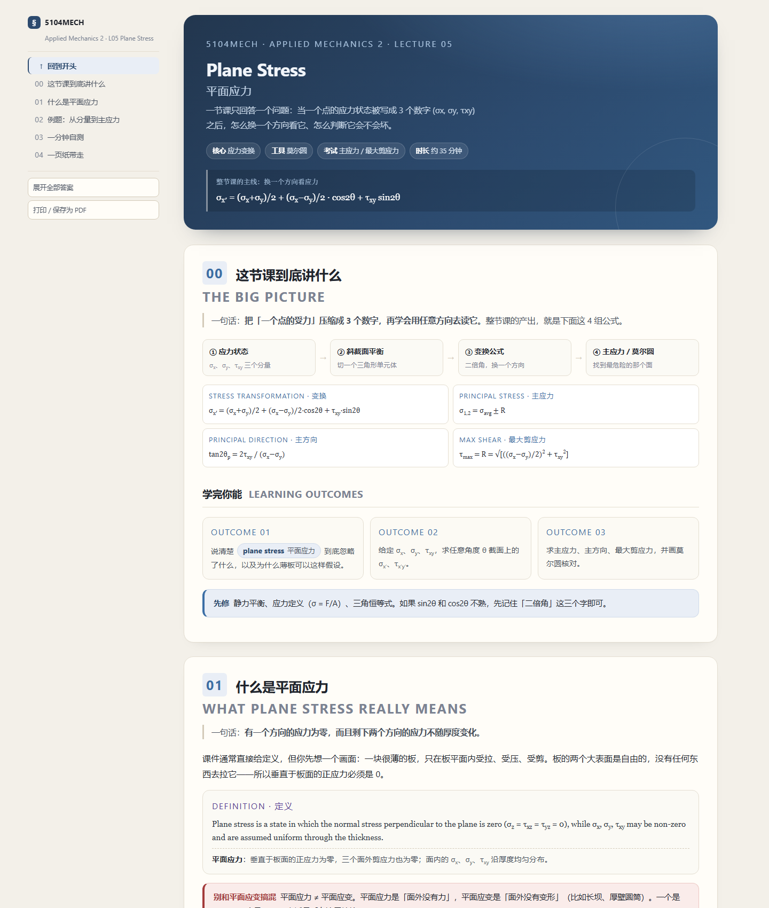

# course-notes · 课件 → 学习页

把一节课的 **PPTX / PDF** 变成**一个单文件、离线可开、中英双语**的 HTML 学习页：
先讲清「这节课到底在干嘛」，再按知识点讲懂、配图、配例题、配自测，左侧自动生成导航。

不是复习提纲，是**第一次学**用的讲义。

> A skill for **DeepSeek Harness** (also usable as a plain Python toolkit) that turns a lecture deck
> into one self-contained, offline, bilingual HTML study page. See [English](#english) below.



---

## 它解决什么问题

课件是**给人讲的提纲**，不是给人读的讲义：一页 PPT 常常只有「环向应力 σH = Pr/t」一行字，
而真正难的是——为什么是 Pr/t？为什么轴向只有一半？600 页 PDF 里没有答案。

这个工具把一节课重写成一条**认知路径**：

```
问题 → 直觉 → 定义/公式 → 分步推导（每步写「为什么」）→ 例题（答案折叠）→ 易错 → 自测
```

配套的硬规则写在 [`SKILL.md`](SKILL.md) 里，其中最要紧的一条是：
**不要把 PPT 的句子抄成要点**——先读懂，再重讲；PPT 只提供知识点清单、图、原题和数据。

## 产出的页面长什么样

| 区块 | 内容 |
|---|---|
| 首屏 | 课程/课次/标题（英文主标题 + 中文副标题）、三句话导读、一颗核心公式、四个 chips |
| 总述 | 一句话总结 + 路线图 + 3–6 张公式卡 + 学习目标 + 先修 |
| 知识点 | 一句话 → 直觉 → 英文定义（可背）+ 中文解释 → 分步推导 → 图（含「看图要点」） |
| 例题 | 英文原题 + 中文题意，难度星级，解答默认折叠，答案与自查独立复算 |
| 易错点 | 错法 → 为什么错 → 正确做法，只写这节课真会错的 |
| 一页纸带走 | 结论、公式卡、术语表、可勾选清单（localStorage 记忆）、即时反馈自测 |
| 导航 / 打印 | 左侧目录滚动高亮、手机抽屉；A4 打印自动隐藏导航、展开答案 |

技术上的几个约束是刻意的：

- **零外部依赖**：没有 CDN、没有 MathJax/KaTeX、没有外部字体，公式用 Unicode + CSS 类（`.frac` `.sqrt` `.eq`）手写。断网、发微信、丢手机上都一样。
- **图片 base64 内嵌**：交付物是**一个** html，图全在文件里。把 html 单独拖到别处也不会白框（这事真的发生过）。
- **双语按信息层级分配**：标题/术语/定义/题干 = 英文为主，讲解/推导 = 中文为主，考试问法单独给英文句式。

## 安装（作为 DSH 技能）

```bash
git clone https://github.com/<your-name>/course-notes.git ~/.dsh/skills/course-notes
```

Windows 下就是 `%USERPROFILE%\.dsh\skills\course-notes`。重启会话后，技能目录里会出现
`course-notes`，说一句「用 course-notes 把这份课件做成学习页」即可触发。

## 依赖

```bash
pip install python-pptx pillow pypdfium2
```

- `.pptx` 路线：`python-pptx` 取文字/表格/备注/内嵌图 + **PowerPoint COM**（Windows）导出整页 PNG。
- `.pdf` 路线：`pypdfium2` 取文字层并渲染每页。
- 没有 Office 也能用：先用 LibreOffice 把 pptx 转成 pdf，再走 PDF 路线。
- 两个解释器的情况（一个装了 python-pptx、另一个装了 pdfium）：用环境变量 `CN_PY` / `CN_PY_ALT` 指定，
  脚本缺库时会自动切过去重跑。

## 手动跑流水线

```bash
# 1. 抽取：文字 + 逐页渲染 + （pptx）内嵌图
python tools/extract_deck.py "lecture.pdf" --out "lectures/appmech/05-thin-walled/work"

# 2. 扫版式：几页拼一张联系表，一次看 4–6 页
python tools/tile.py --dir "…/work/pages" --out "…/work/sheets" --pages 1-24 --per 4 --scale 0.5

# 3. 裁图：从整页渲染里裁到只含目标图（box 用 0–1 的小数坐标）
python tools/crop.py --src "…/work/pages/page-26.png" --box 0.62,0.37,1.0,0.73 \
    --out "…/img/hoop-cut.png" --trim --pad 0.01

# 4. 构建：body.html + shell.html → index.html（自动生成侧栏、检查锚点与缺图）
python tools/build.py "…/body.html" "…/index.html" \
    --course "5104MECH" --lecture "Applied Mechanics 2 · Lecture 5"

# 5. 打包：把 img/… 全部换成 data: URI，得到一个可以随便转发的单文件
python tools/inline.py "…/index.html" "…/index-single.html"
```

`body.html` 只写正文片段（从 `<section class="hero">` 开始），
`shell.html` 提供样式/交互/打印，`build.py` 负责把 `{{TITLE}} {{NAV}} {{COURSE}} {{LECTURE}} {{BODY}}` 填进去。

## 目录结构

```
course-notes/
├─ SKILL.md                 执行规范（工作流、写作语气、检查清单）——真正的"技能"
├─ shell.html               页面外壳：样式、导航、quiz、打印排版
├─ tools/
│  ├─ extract_deck.py       pptx/pdf → text.md + slides.json + pages/*.png
│  ├─ tile.py               4–6 页拼一张 contact sheet，快速扫全 deck
│  ├─ crop.py               从整页渲染里裁图（支持自动去白边）
│  ├─ build.py              body.html + shell.html → index.html
│  └─ inline.py             index.html → 图片内嵌的 index-single.html
└─ sample-plane-stress/     样张（平面应力）：可以直接双击 index.html 看效果
```

工作目录按课次组织，源文件与产物分开：

```
lectures/<course>/<lecture>/
├─ body.html          我写的正文（唯一需要手写的文件）
├─ index.html         构建产物（分文件版，便于反复改）
├─ index-single.html  交付产物（图全内嵌）
├─ img/               裁出来的图 / 重绘的 SVG
└─ work/              抽取产物：text.md、slides.json、pages/、sheets/
```

## 几个设计取舍

**为什么必须逐页看图。** 课件里「一张图 + 三个箭头」往往就是老师真正讲的内容；
只读文字层会漏掉一半：分步动画（同一页导出成多张近似页）、红框高亮、手写批注、公式图片。
所以流水线里 `read_image` 是强制步骤，不是可选项。

**为什么不用 MathJax。** 离线可开是硬指标，而公式其实只需要分式、根号、上下标三种排版。
`shell.html` 里用 `.frac` / `.sqrt` / `.sub` 几个类就够了，代价是写公式时要用 `<span class="frac">`，但换来的是零依赖和可打印。

**为什么交付单文件。** 早期版本交付 `index.html + img/`，用户把 html 单独拖到桌面后图全丢。
现在 `inline.py` 把每张图转成 base64 塞进文件，一个 html 就是一个完整作品；分文件版只留在工作目录里供迭代。

**为什么先给「看图要点」。** 工科课件的图信息密度极高（受力方向、投影面积、尺寸标注），
新手盯着图也不知道该看哪里。所以每张图下面固定一段「看图三步」：先看什么、再看什么、最后想什么问题。

## 已知限制

- **扫描版 PDF 没有文字层**：这时只能靠 `pages/*.png` 逐页读图，抽取脚本会提示 `text layer: no`。
- **动画分步页**：同一页会导出多张近似页，`text.md` 里有重复段落是正常的，以最后一页 + 备注为准。
- **公制单位**：例题默认 SI，埋单位陷阱（mm→m、MPa→Pa）是刻意的教学设计。
- **依赖 Office**：pptx 的整页渲染走 PowerPoint COM（Windows）。跨平台请先转 PDF。
- **不适合超长内容**：一页超过 ~12 节就该拆成「上/下」，或者重新思考课程结构。

## English

`course-notes` turns a lecture deck (`.pptx` / `.pdf`) into **one** self-contained HTML study page:
offline, no CDN, images inlined as base64, with a generated sidebar, collapsible worked examples,
and an English/Chinese split tuned for courses that are taught in English but studied in Chinese.

The workflow is written for an agent (see [`SKILL.md`](SKILL.md)): extract text **and** page images,
read every figure, re-order the material by dependency rather than by slide order, then write the page
with step-by-step "why" reasoning, worked examples with folded solutions, a mistake list and a self-test.

Tools are plain Python and work standalone:

```bash
python tools/extract_deck.py deck.pdf --out work
python tools/build.py body.html index.html --course "5104MECH" --lecture "Lecture 5"
python tools/inline.py index.html index-single.html
```

Requires Python 3 with `python-pptx`, `Pillow` and `pypdfium2`. Open `sample-plane-stress/index.html`
to see what the output looks like.

## License

MIT — see [LICENSE](LICENSE).

## 致谢

页面外壳（`shell.html`）的排版与交互、以及 `SKILL.md` 里的写作规范，是在多次迭代中打磨出来的；
`sample-plane-stress/` 是纯示意样张，不含任何第三方课件的图。
如果你用它做了课程笔记，注意课件本身的版权归授课教师/学校所有，**不要把自己的学习页连同课件原图一起公开发布**。
